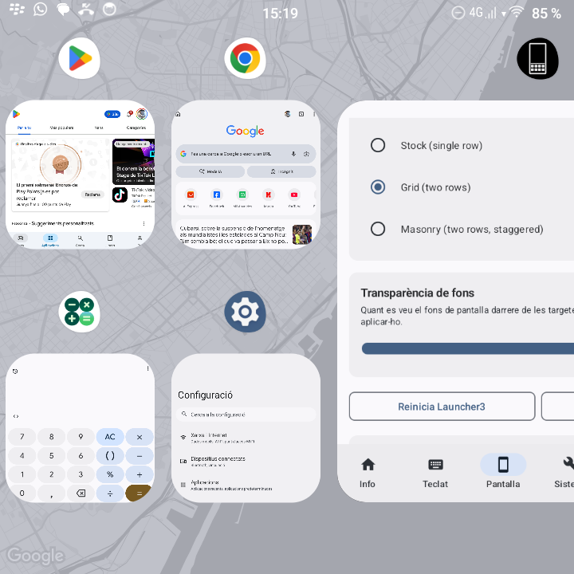
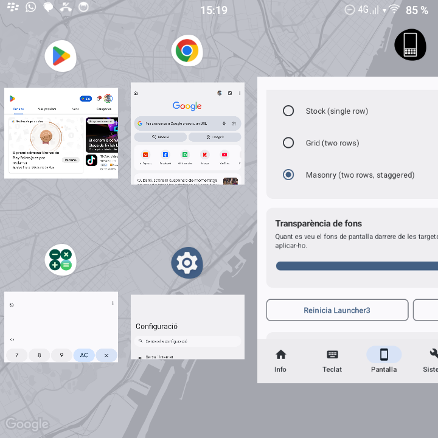

# Q25 Toolbox

A root app for the Zinwa Q25 (MediaTek, physical QWERTY keyboard) that collects
device tweaks in one Material You interface. It runs on **BenOS, ZinwaOS and
LineageOS 23** (the 24 beta is untested). The ROM is detected from the build
properties (shown in Info, overridable in Settings) and modules that make no
sense on it are hidden, never removed: BenOS behaviour is not changed by
anything added for LineageOS.

| Grid | Masonry |
| --- | --- |
|  |  |

## Contents

1. [Requirements](#requirements)
2. [Install and update](#install-and-update)
3. [Modules](#modules)
4. [LineageOS notes](#lineageos-notes)
5. [Edge Gestures](#edge-gestures)
6. [Recents UI Layout](#recents-ui-layout)
7. [Other modules](#other-modules)
8. [Architecture](#architecture)
9. [Backup and restore](#backup-and-restore)
10. [Build, test, release](#build-test-release)
11. [Extending](#extending)
12. [Credits](#credits)

## Requirements

| Need | For | Notes |
| --- | --- | --- |
| Root | almost every module | Tested with KernelSU Next. The app's own root shell does not see other apps' data (per-app mount namespaces), so anything that reads another app's files goes through `nsenter --mount=/proc/1/ns/mnt`. |
| The accessibility service enabled | key handling, per-app features, Recents overlays, Edge Gestures, Ticker | Settings, Accessibility, Q25 Toolbox. Each affected screen shows a banner with a link when it is off. Updating over an existing install keeps the grant; a fresh install needs it again. |
| An Xposed framework (LSPosed or Vector) | LSPosed Grid on BenOS/ZinwaOS, switching off the native bottom gesture | Optional. Without it Recents uses the standalone overlays and the native bottom gesture stays on. |
| Zygisk (Magisk, ReZygisk, Zygisk Next) | Zygisk Detach | Optional. |

Minimum Android is 9 (API 28); the app targets API 34.

## Install and update

Releases are on [GitHub](https://github.com/nozerorma/q25toolbox/releases).
Download the `.apk` and install it, or let the in-app updater do it (Settings,
Updates: it fetches the release's `.apk` and installs it with `pm install -r`).
[Obtainium](https://github.com/ImranR98/Obtainium) works too, because the
`versionName` carries the same `v` prefix as the tag.

All releases since v3.1 are signed with the same key (the debug key, see
[Build](#build-test-release)), so each installs over the previous one and
keeps its settings. A build signed with a different key cannot update them.

| App version | Use it if | Recents |
| --- | --- | --- |
| v4.0 and later | BenOS, ZinwaOS or LineageOS 23; Xposed optional | standalone overlays on any ROM, plus the LSPosed hook on BenOS/ZinwaOS |
| v3.0 | a stock-based ROM with an Xposed framework | LSPosed hook |
| 2.1.1 | BenOS beta3 without Xposed | bundled patched launcher (bind mount) |
| 2.0.5 | BenOS before beta3a | older patched launcher |

Updating from 2.x removes the old bind-mounted launcher on first launch.

## Modules

Six bottom-bar sections. "ROM" says where the entry is shown.

| Section | Module | Needs | ROM |
| --- | --- | --- | --- |
| Info | Device status, battery usage breakdown | root (battery usage) | all |
| Keyboard | Key Remapper (on LineageOS also: leave the Recents key to Key Mapper) | root | all |
| | PIN on keyboard (lockscreen) | root (also before first unlock), accessibility | all |
| | Per-app keyboard block | root, accessibility | all |
| | Chat Enter-to-send, calculator keys | accessibility | all |
| | IME suggestion shortcuts, in-call shortcuts | accessibility | all |
| | BlackBerry keyboard strip | root | LineageOS |
| Screen | Extra dimming, per-app display scaling, forced rotation | root | all |
| | Recents UI Layout | root, accessibility | all (LSPosed part: BenOS/ZinwaOS) |
| | **Edge Gestures** | accessibility; LSPosed for the native bottom gesture | all |
| System | BesLoudness | root | BenOS, ZinwaOS |
| | Auto-focus input, Ticker Notifications | accessibility | all |
| | Proximity workarounds (call screen recovery) | root | BenOS, ZinwaOS |
| | Call Proximity Sleep, Double-Tap to Wake | root, accessibility | LineageOS |
| | **Advanced Settings (System Hotfixes)** | root (Hybrid Mount optional/recommended) | all |
| Network | AdBlock, per-app Telemetry block | root | all |
| | Zygisk Detach | root, Zygisk | all |
| | Wireless ADB, Bluetooth and Location auto-disable | root | all |
| Settings | Updates, quick links, backup and restore, debug log export, about | | all |

## LineageOS notes

Facts below were verified on a Q25 running LineageOS 23 (Android 16, kernel
5.10, KernelSU Next); where something is inference it says so.

- **Keyboard driver.** `Q25_keyboard` must never be unbound and rebound:
  `bbqX0kbd.ko` registers a display notifier and imports no unregister, so a
  panel-on while unbound is a kernel NULL dereference. The keyboard is reloaded
  with a uevent remove/add on its input node instead (`RomProfile.keyboardRebindUnsafe()`).
  BenOS keeps the unbind/bind reload.
- **Keylayout.** The file is `/vendor/usr/keylayout/Q25_keyboard.kl`. A
  bind-mounted copy must be labelled `u:object_r:vendor_keylayout_file:s0`;
  with `vendor_file` the system is denied access and silently uses `Generic.kl`.
- **Physical Recents key.** The system opens its own Overview on scancode 580
  even if an accessibility service consumes the key. While an overlay Recents
  mode is on, the key is remapped to `PROG_RED` and the service treats that as
  the trigger.
- **Recents key and Key Mapper.** The system opens its own Overview on `APP_SWITCH`, and an accessibility service
  can add an action but not replace that one, so Key Mapper cannot take the key over by itself. The switch
  "Leave the Recents key to another app" (Keyboard, Key Remapper) keeps scancode 580 remapped to `PROG_RED` (the
  system ignores it) and makes this app stand down, so Key Mapper sees keycode 183, scancode 580 on any device and
  can bind short, double and long presses, with its own vibration. Key Mapper's built-in "Recents" action performs
  `GLOBAL_ACTION_RECENTS`, which opens the system Overview, not our overlays. To open ours, use Key Mapper's *Send
  intent*: type Broadcast, action `com.kgr.q25toolbox.action.RUN`, package `com.kgr.q25toolbox`, and optionally the
  string extra `action` (`RECENTS` by default, or any Edge Gestures action such as `PREVIOUS_APP`). The receiver is
  exported, so any app can send it, and it is ignored on the keyguard. Without the switch, the key opens our
  overlay while an overlay Recents mode is on.
- **No system gesture navigation.** Settings shows no "System navigation" page
  because it requires `WindowManager.hasNavigationBar(0)`, which is false here:
  the ROM treats the Q25 as having hardware Back/Home/Menu keys.
  `navigation_mode=2` is set but inert. Writing Lineage's `force_show_navbar=1`
  (through `content://lineagesettings`, with a reboot) did **not** change
  `mForceShowNavigationBarEnabled`, create a navigation window or enable
  SystemUI's edge back handler. Tested once, on one build; what gates it is not
  known. Edge Gestures therefore draws its own strips.
- **AdBlock.** KernelSU Next without a metamodule mounts nothing from a
  module's `system/` tree, so the compiled hosts file is bind-mounted by the
  module's `service.sh` (and checked on each app launch) when the overlay is missing.
- **Lockscreen.** Enter and the keypad activate whatever has focus. The app
  intercepts them and opens the PIN pad with `wm dismiss-keyguard`.
- **Hidden on LineageOS:** BesLoudness (MediaTek HAL parameter), call screen
  recovery, the always-on DT2W watchdog.
- **BlackBerry keyboard shows its full on-screen keyboard (fixed in 4.1.2).** With the BlackBerry keyboard
  (`com.blackberry.keyboard`, AA001.021Q25P) the full keyboard sometimes replaced the suggestions strip (469 px
  against 148 px in `dumpsys input_method`). Cause, from the keyboard's decompiled code and AOSP
  (android16-release): the keyboard shows the full keyboard when its configuration is landscape
  (`Build.DEVICE != "venice" && orientation == LANDSCAPE`; here `Build.DEVICE` is `Q25`). It targets SDK 27, so
  `ConfigurationContainer.applySizeOverrideIfNeeded` gives its process the legacy configuration with the status bar
  (34 px) taken off the height: 597 x 569 dp, landscape on the square screen, while the display itself reports
  597 x 597 dp. Apps that target SDK 35 or later never get that. A display-size round trip (the per-app scaling, or
  `wm size`) reproduced it every time. The framework has a per-app switch for it, the overridable compat change
  `OVERRIDE_ENABLE_INSETS_DECOUPLED_CONFIGURATION`; **Keyboard, BlackBerry keyboard strip** turns it on for that one
  package (`am compat enable`, which restarts the keyboard once) and checks the real state before acting. No Xposed.
  Measured: with it on, the keyboard's process and window stay at `h597dp port` through display-size round trips.
  Not tested: every other possible trigger one by one, and survival across a reboot (the app re-applies the switch
  whenever the accessibility service starts).
## Edge Gestures

`GestureStripsController`, `EdgeSwipe`, `GestureArrowView`,
`xposed/GestureHookInit`. Back, Home, Recents and more from the screen edges,
for ROMs where system gesture navigation is unavailable (LineageOS on the Q25)
or unwanted. Screen tab, "Edge Gestures".

**Zones.** Left, right and bottom are configured independently (a copy button
mirrors one side onto the other). Each is Off or Custom, with strip thickness
(6 to 32 dp), length (20 to 100 % of the edge) and swipe distance (8 to 80 dp,
shown in millimetres too).

**Gestures and actions.** Each gesture has a plain-swipe action and a hold
action (held 350 ms past the threshold; a hold with no action assigned lets the
release run the swipe action). Side edges tell three swipes apart, by the angle
of the finger's travel: straight (under about 31 degrees from the inward axis),
diagonal up and diagonal down (up to about 63 degrees). The bottom edge swipes
up. Actions: Back, Home, Recents, Notifications, Quick settings, Lock screen,
Screenshot, Power menu, Split screen, Flashlight, Previous app, None. Most map
to `performGlobalAction`
([constants](https://developer.android.com/reference/android/accessibilityservice/AccessibilityService#GLOBAL_ACTION_BACK));
the flashlight uses
[`CameraManager.setTorchMode`](https://developer.android.com/reference/android/hardware/camera2/CameraManager#setTorchMode(java.lang.String,%20boolean)),
which needs no camera permission.

| Gesture | Swipe | Hold |
| --- | --- | --- |
| Side, straight | Back | Previous app |
| Side, diagonal down | Notifications | none |
| Side, diagonal up | Quick settings | none |
| Bottom, up | Home | Recents |

*Previous app* resumes the second task from the Recents task list, or the first
when the app in front is the home launcher (which the list leaves out). If the
service does not yet know the foreground app (just after the screen turns on)
the guess can be one task off.

**How it is drawn.** Each strip is a thin `TYPE_ACCESSIBILITY_OVERLAY` window
that gets the touches landing on it. Consequence: a plain tap on a strip is
swallowed, so keep strips thin or switch a zone off. Strips are removed with the
screen off and on the keyguard, and in apps listed under "Apps without strips".
A debug switch tints them.

**Native bottom gesture.** The launcher's swipe-up (home, recents, quick
switch) is an input-monitor spy window, so it sees the same touches as the
strip and cannot be blocked from another window. `GestureHookInit` (LSPosed,
scoped to `com.android.launcher3`) skips `TouchInteractionService.onInputEvent`
while `Settings.Global q25_native_bottom_gesture_off` is 1. The switch is
independent of the strip; until the user touches it, it follows the strip (on
while the strip is Custom). On its first call the hook writes
`files/q25toolbox_gesture_hook.state` in the launcher's data directory
(`ok=1` plus the launcher `versionCode`); the app reads it through PID 1's mount
namespace and shows "running", "checking" or "not detected". The same
technique is used by Key2 Toolbox's navigation-bar hook. There is no predictive
back: that animation belongs to the native side gesture, which is unavailable
here.

**Arrow overlay (optional, per zone).** A badge slides out of the edge following
the finger, turns with the real direction of travel, changes colour once the
swipe is past its threshold ("release to fire"), and flies off or retracts on
release. It lives in one full-screen window with `FLAG_NOT_TOUCHABLE`, so it
never takes a touch. Style, shared by the zones: arrow, idle and active colours (a fixed swatch, a hex value, or on Android 12+ an entry of the Material You palette by family and tone, such as `accent1:500`, kept as a reference and resolved when a gesture starts, so it follows the wallpaper; the saved colour is the fallback),
size, slide-out distance, opacity, thickness, animation speed, round badge or
bare arrow, tilt on or off, with a live preview. Defaults: bare white arrow,
grey idle and black active colours for the badge, 70 % opacity, 50 dp travel.

**Vibration.** The Q25 vibrator declares no predefined effects and no amplitude
control, and the system haptic played for `performHapticFeedback` was not
perceptible (the vibrator log showed a `TICK ... with fallback` of about one
second). The strips therefore call `Vibrator` directly: a short tick when the
distance is crossed and a longer pulse on the action, both with configurable
duration. In one measurement a 35 ms pulse started about 0.7 s after it was
requested, so latency may be a limit of the motor driver.

**Settings** live in `q25tweaks` under `gest_*` and are applied live. Left and
right fall back to the single side setup of earlier builds (`gest_lat_*`) for any
value not yet saved.

## Recents UI Layout

`RecentsTweaksController`, `SlimRecentsController`,
`service/*RecentsOverlayController`, `xposed/RecentsHookInit`. Three layouts,
stored in `Settings.Global`.

**Standalone overlays (any ROM, no Xposed).** *Slim List*, *Masonry* and *Grid*
are drawn by the accessibility service as `TYPE_ACCESSIBILITY_OVERLAY` windows
([reference](https://developer.android.com/reference/android/view/WindowManager.LayoutParams#TYPE_ACCESSIBILITY_OVERLAY)).
Slim List and Masonry share one controller; Grid has its own (newest tile at
the right edge, older ones in two rows, "Close all" at the far end).

- **Source.** `dumpsys activity recents` for tasks, the system snapshot cache
  (`/data/system_ce/<user>/snapshots/`, inside a UUID-named subdirectory on
  Android 16) for thumbnails, read with root. The app in front gets a live
  `screencap` (0.24 s measured on the Q25), since it has no stored snapshot yet.
  Resume uses `am start` with `FLAG_ACTIVITY_REORDER_TO_FRONT`, skipped for the
  app already in front; dismiss uses `am stack remove <rootTaskId>` (the root,
  not the leaf, task id on Android 16).
- **Trigger.** The physical Recents key, via the `PROG_RED` remap described
  above. The on-screen button and gesture cannot be intercepted and still open
  the stock Overview; Edge Gestures can open the overlay instead.
- **Exit.** The tile you pick (or the newest, on Back) grows to full screen while
  the scrim fades. In Slim List and Masonry the overlay waits for the picked app
  to be in front (900 ms at most) before that; in Grid, Back and a tap on the
  background expand the newest tile, and Home is a plain fade. The blur is
  switched off in one step when the exit starts, and the window is removed softly
  (alpha 0, then 48 ms later), a workaround for a stale frame seen on Android 15
  that is not known to be needed on Android 16.
- **Settings.** Background colour (dark or Material You), opacity, blur
  (cross-window blur, when the system allows it), animation length (0 = none;
  durations also follow the system animator scale), tile corner radius for Grid
  and Masonry.
- **Performance.** Label and icon lookups are cached per package (invalidated by
  the package's `lastUpdateTime`) and banner colours are computed on the worker
  before the window is shown. A tile without a stored snapshot fades instead of
  expanding into a black rectangle.

**LSPosed Grid and Masonry (BenOS/ZinwaOS).** `RecentsHookInit`, scoped to
`com.android.launcher3`, patches the running launcher by method name in memory:

- `DisplayController.Info.isTablet(WindowBounds)` returns true while a grid mode
  is active (the `DeviceProfile` constructor derives all Overview geometry from
  it); `showAsGrid()` is pinned too.
- `DeviceProfile.recalculateHotseatWidthAndBorderSpace()` is skipped (forcing
  tablet makes it divide by zero; the launcher's hotseat is never shown).
- `overview_grid_row_spacing`, `overview_grid_side_margin` and the grid icon
  size are backfilled where the phone resource bucket gives 0 (on Android 16 they
  sit in a nested `overviewProfile`).
- `isTaskbarPresent` is cleared so the floating taskbar does not appear.
- Masonry shortens each `TaskView` by a factor keyed on the task id; the
  launcher's own `updateGridProperties` re-centres it.

A runtime hook survives OTAs and fails soft (stock Overview), unlike the pre-v3
patched launcher.

**Grid (auto).** The single "Grid" choice uses the hook when it demonstrably
works in the installed launcher, and the standalone overlay otherwise.
Evidence is a handshake: once per launcher process the hook writes
`files/q25toolbox_hook.state` (`ok=1` only if all four Grid hooks attached, plus
the launcher `versionCode`). A missing file or another `versionCode` is
"unknown" and a failed hook "broken"; only "ok" turns the hook on (an install
updating from v3 keeps its working hook until the new one has run once). "Grid,
standalone" never uses the hook.

`Settings.Global` keys: `bb_recents_layout_mode` (0 stock, 1 grid, 2 masonry),
`q25_recents_scrim_alpha`, `q25_recents_overlay_mode`, `q25_recents_hook_ok`.
"Restart Launcher" and "Restart SystemUI" use `kill -9` on the real PID, since
`am force-stop` does nothing for persistent processes.

## Other modules

**Key Remapper** (`KeyRemapController`). Remaps the Currency key (`GRAVE`,
scancode 41, miswired in firmware), Right Shift (54) or the Recents key
(`APP_SWITCH`, 580) to Right Ctrl by rewriting the keylayout through a
bind-mounted copy. On BenOS the generated boot script unbinds the i2c driver so
EventHub releases the file, copies the pristine layout, edits the scancode,
labels it `system_file`, mounts it and rebinds the driver (`/sys/bus/i2c/drivers/Q25_keyboard`,
device `6-001f`). The same script runs live on save. It refuses to mount an
empty layout, which would leave the keyboard dead at every boot. On LineageOS
see [LineageOS notes](#lineageos-notes).

**PIN on keyboard** (no root). While the keyguard is locked, key presses become
taps on SystemUI's PIN pad through `AccessibilityNodeInfo`. Digits follow the
phone dialpad on QWERTY: `W E R` = 1 2 3, `S D F` = 4 5 6, `Z X C` = 7 8 9,
`Q` = 0. The button is found by the known resource id, with a text and content
description search as fallback.

**Lockscreen Enter opens the PIN** (root, on by default only on LineageOS).
Enter, keypad Enter and D-pad centre are intercepted on SystemUI's own keyguard
and the PIN pad opens with `wm dismiss-keyguard`; over-lockscreen apps (an
incoming call) keep their keys. An optional switch also swallows D-pad, Tab and
Space so a keyboard pressed in a pocket cannot reach the emergency-call button.

**Per-app keyboard block** (`Q25PassthroughIme`). In chosen apps key presses go
straight to the app. The service switches the default IME to a bundled
do-nothing IME with `ime enable` and `ime set` (root) and restores the previous
one on leaving. The package list is a `StringSet` in `q25tweaks`.

**Chat Enter-to-send and calculator keys** (no root; ported from
[smh786/q25-input-helper](https://github.com/smh786/q25-input-helper), classes
under `inputfix/`). Enter in a set of messaging apps clicks the send button
(Alt or Shift+Enter stay a newline); in the AOSP/Google Calculator digits and
operators press the calculator's buttons. Both off by default.

**IME suggestion shortcuts** (no root). Ctrl+W/E/R clicks the 1st, 2nd or 3rd
clickable `TextView` of the keyboard's candidate strip (confirmed with the
BlackBerry keyboard). The key is consumed only if a suggestion was clicked.
These shortcuts need the strip to be visible.

**In-call shortcuts.** In Google Phone's call screen: M mutes, the Currency key
toggles speaker, and `W E R S D F Z X C 0` insert dialpad digits with
`ACTION_SET_TEXT` (more reliable than `input keyevent` right after the dialpad
transition). They run before Auto-focus on that screen, identified by the
keypad, mute and speaker toggles.

**Auto-focus input.** On a printable key in selected apps, focuses the first
editable field and inserts the key once the field has input focus (woken by the
next accessibility event, with a 1 s timeout). Each insertion is followed by
`ACTION_SET_SELECTION` to the end, otherwise the IME inserts the next letter at
offset 0, capitalized. Keys pressed meanwhile are appended in order. A "no
editable field" result is cached briefly.

**Extra dimming.** Drives Android's Extra Dim (`reduce_bright_colors_*`) with an
intensity slider and an optional night schedule (`service.d` watchdog, to the
minute, writes only on transitions so manual overrides survive).

**Per-app display scaling.** This ROM ignores per-app scaling (compat-framework
`DOWNSCALE_*`, GameManager, `wm density`: no effect, verified), so the service
switches the global `wm size` when a chosen app is in front and resets it on
leaving and on teardown. Presets follow
[duc1607/q25-res-changer](https://github.com/duc1607/q25-res-changer) (720x720,
720x772, 720x960, 720x1280, 720x1440; the SystemUI-breaking 780x780 is omitted)
plus a custom size. The screen relayouts briefly on each switch.

**Resolution hotkey** (in Per-app display scaling; off by default). A global key combination (left or right Ctrl, Alt,
Shift or Meta, plus a letter or digit; default Right Shift + R) steps the whole screen through an ordered list of
resolutions and back to the default; with one resolution it is a toggle. It acts on a short press or when held for
0.5 s. In the held mode a quick tap is typed again on release (`input keycombination` through root, ignoring events of
virtual devices so it never reacts to itself). It wins over the per-app targets and survives the screen turning off;
tearing the service down restores the default. It gives the Edge Gestures vibration pulse and a short toast.
A display-size change is exactly what used to bring back the BlackBerry keyboard's full keyboard on LineageOS; keep
the BlackBerry keyboard strip switch on if you use this there.

**Forced rotation.** Locks the screen to one rotation (portrait, landscape, reverse portrait, reverse landscape) or to
auto-rotate, for all apps or per app. The service writes `user_rotation` plus `accelerometer_rotation` through root for
the foreground app (its own entry, else the general state). An app that declares its own `screenOrientation` beats that
lock, so an optional switch (on by default) also sets `wm set-ignore-orientation-request true`, where the command exists.
The values the user had are saved in the prefs before the first change and put back when the state returns to "System",
on teardown and after a service restart. Not verified on a device yet: how each app reacts to the override, and the
`wm` command on the BenOS build.

**BesLoudness** (BenOS/ZinwaOS). Toggles the vendor speaker DSP stage with
`AudioManager.setParameters("SetBesLoudnessStatus=0/1")`, as the stock Sound
Enhancement screen does. `persist.vendor.audiohal.besloudness_state` is a red
herring (no audible effect). The optional schedule is a shell watchdog that
hands off to `BesLoudnessReceiver` with `am broadcast`.

**Proximity workarounds** (BenOS/ZinwaOS). After a call, if the screen is still
off 5 s later (confirmed against `dumpsys telecom`), wakes it. A manual "respawn
keyboard" button rebinds the keyboard driver; it is deliberately not automatic,
because pairing the rebind with a forced wake raced the display driver and
crashed the kernel. Also a live proximity and Lux monitor and a launcher for the
OEM factory test (`P_SensorTestActivity`; a readout only, there is no
calibration write path).

**Ticker Notifications.** A scrolling banner instead of heads-up popups,
drawn as a `TYPE_ACCESSIBILITY_OVERLAY` window (a `TYPE_APPLICATION_OVERLAY`
window renders under the status bar on this device; the choice follows Super
Status Bar, `com.tombayley.statusbar`, decompiled). Notifications arrive
through a listener granted with `cmd notification allow_listener`. Heads-up
stays enabled and is turned off only around a ticker, so notifications the
ticker declines pop up normally; one can still slip through in the race with
SystemUI. Swiping down on the banner opens the shade. Configurable: tap to
open, minimum priority, per-app and per-category blocklists, ongoing
notifications, body lines, scroll speed and delay, background colour (fixed,
icon colour via `androidx.palette`, or Monet).

**Call Proximity Sleep** (LineageOS). Detects a call from the audio mode,
registers the proximity sensor only during the call, and after a short debounce
sends `KEYCODE_SLEEP` (and `KEYCODE_WAKEUP` on far or call end). Earpiece only,
never speaker, Bluetooth or wired audio.

**Double-Tap to Wake** (LineageOS). The kernel has no gesture wake, but the
touch controller keeps reporting taps with the screen off. `dt2w_lineage.sh`
runs only while the screen is off (started and stopped by the service on
`ACTION_SCREEN_OFF` and `ACTION_SCREEN_ON`) and sends `KEYCODE_WAKEUP` after two
taps within 0.8 s. Measured: spaced taps all arrive, fast bursts lose about one
in four. The older always-on watchdog degraded SystemUI and stays hidden.

**AdBlock.** Systemless hosts blocking (based on
[gloeyisk/systemless-hosts](https://github.com/gloeyisk/systemless-hosts)):
a root-manager module with about 273k bundled entries, your own blacklist and
whitelist, subscribable lists and live pause. `hosts_ctl.sh` owns compilation;
one reboot activates the overlay, later edits are live.

**Telemetry Block.** Per-app opt-in: only enrolled packages are touched. For
each it forces off the persisted collection flags of Firebase Crashlytics,
Analytics, Performance and the Firebase master flag. SDKs re-derive them at
cold start, so `block_telemetry.sh` is a watchdog (burst after boot, rescan
every 10 minutes and whenever `packages.list` changes), run in PID 1's mount
namespace with a PID and `cmdline` lock. Updating from v3.1 enrols every app
the old global block covered.

**Zygisk Detach.** Installs the bundled `zygisk-detach` module (a hook on
libbinder in the Play Store process hiding chosen packages from
`getApplicationEnabledSetting`) and manages its list. Install and enable take
effect at boot; list changes when the Play Store restarts.

**Wireless ADB.** Persists a port with `service.d/adb_wireless.sh` (waits for
`sys.boot_completed`, sets `adb_wifi_enabled` and the TCP port properties) or
applies it live; shows the WLAN address.

**Bluetooth and Location auto-disable.** Watchdogs that turn the radio off
after 5 to 60 idle minutes (default 15). The idle deadline is wall-clock
(`date +%s`), not a count of 60 s passes, because `sleep` stops while the
device suspends. Bluetooth connection detection combines four specific signals
from `dumpsys bluetooth_manager`; Location idleness is the GPS provider going
unused, since GMS listeners are always registered. Disables are verified and
logged to `/data/adb/.bt_idle.log`.

**Battery usage.** Per-app percentage and mAh since the last reset from
`dumpsys batterystats --checkin`, because the native screen never populates
here (it needs a `BATTERY_STATUS_FULL` the charger never reports). Auto-resets
at a charge threshold. Cycle count is not shown: the gauge reports a static
value.

**Settings tab.** Update check (version cores and pre-release suffixes compared
properly), links to Accessibility and Input Method settings, a SystemUI
restart, a Notification Access shortcut, "Export debug logs" (the current
`logcat -d` plus a header, to `Documents/q25toolbox/`), contributors and about.

## Architecture

**Accessibility service.** `Q25AccessibilityService` is long-lived and owns
everything that needs observation (foreground app, windows, IME, key events),
because a one-shot root command cannot be told when something happens. It
exposes itself as `instance`, since a `TYPE_ACCESSIBILITY_OVERLAY` window can
only be added from a running service's context. Its settings are in the
`q25tweaks` SharedPreferences, which the service listens to, so changes apply
live. A reinstall kills the service for a moment and restarts the IME.

**Outside callers.** `RunActionReceiver` (exported broadcast receiver) runs one of
the gesture actions for another app, mainly Key Mapper; see the LineageOS notes.

**Root modules.** Stateless ones run commands on demand and persist by
installing scripts in `/data/adb/service.d/`. Daemons run detached (`setsid`)
with a lock that checks `/proc/$PID/cmdline`, not just `kill -0`, which
false-positives on a reused PID. A running daemon can still be stale (an old
script holds its lock and loops forever), so `DaemonMaintenance.sweep()` runs
once per app launch, compares installed scripts with what this version would
install, and reinstalls anything stale; it also removes daemons of hidden or
removed features.

**LSPosed hooks** (`assets/xposed_init` lists two classes, scoped to the
launcher): `RecentsHookInit` and `GestureHookInit`. Each is gated by a
`Settings.Global` key (world-readable, written with root) and falls through to
stock behaviour when it is 0. Each leaves a proof-of-life file in the
launcher's `files/` directory.

**State shared with other processes**

| Key | Meaning |
| --- | --- |
| `bb_recents_layout_mode` | LSPosed layout: 0 stock, 1 grid, 2 masonry |
| `q25_recents_overlay_mode` | standalone overlay mode |
| `q25_recents_scrim_alpha` | Overview background opacity for the hook |
| `q25_recents_hook_ok` | whether Grid (auto) currently uses the hook |
| `q25_native_bottom_gesture_off` | 1 = the launcher hook skips the native swipe-up |

**ROM profile** (`core/RomProfile`). A `lineage_*` build flavor (or
`ro.lineage.version`) means LineageOS (major from the build or the SDK level);
a `ro.fota.version` with "BenOS" is BenOS; any other `ro.fota.*` is treated as
ZinwaOS (a heuristic, unverified on stock); otherwise a chooser appears once.
The Q25's LineageOS build has no `ro.lineage.version` and still carries a stale
`ro.fota.version`, so the flavor must win. Hardware-safety decisions use the
detected ROM and ignore the override. `Screen.availableOn(rom)` hides entries.

**Theme.** Material You from the wallpaper on Android 12 and later, following
the system light or dark setting. The status bar icon tint and colour are set
explicitly each recompose, because `Theme.DeviceDefault.DayNight` did not
resolve day or night reliably on this ROM.

## Backup and restore

Settings, Backup: exports the selected modules to a JSON document (through the
Storage Access Framework) and restores from one. Restore merges and never wipes
what is not in the file. It covers the `q25tweaks` modules (PIN keyboard,
keyboard block, IME suggestions, chat, calculator, in-call shortcuts, call
screen recovery, app scaling, auto-focus, battery usage, key remap, Recents
appearance and mode, Zygisk Detach, Call Proximity Sleep, **Edge Gestures**),
Ticker Notifications, and root script state (Bluetooth and Location idle, Extra
Dim, BesLoudness, DT2W, Telemetry with its root-side list). The ROM override is
not backed up, and neither is the proximity monitor. Backups made before Edge
Gestures had separate sides still restore: their `gest_lat_*` keys are read by
both sides.

## Build, test, release

```
./gradlew assembleDebug assembleRelease   # APKs in app/build/outputs/apk/
./gradlew testDebugUnitTest               # JVM tests (no device needed)
```

Both build types are signed with the debug key. `app/build.gradle.kts` has a
commented `signingConfigs` block for a private keystore; if you use it, pass
the password through `gradle.properties` (gitignored) or an environment
variable. Changing the key breaks updates for existing installs.

Unit tests cover the pure logic: ROM detection, keylayout script generation,
hook handshake parsing, the edge-swipe recognizer, and gesture defaults and
settings migration.

Release checklist:

1. Bump `appVersionName` (it must start with `v`, matching the tag exactly:
   Obtainium compares it with the tag) and `versionCode` in `app/build.gradle.kts`.
2. Check that `settings_about_version` does not add a second `v`.
3. Add a `## [X.Y]` entry to `CHANGELOG.md`; update this README for new modules.
4. Build both variants, install the **release** APK, and verify `versionName`
   and that the accessibility service is still enabled.
5. Commit, tag (`git tag -a vX.Y`), push the branch and the tag.
6. `gh release create vX.Y <release apk>`: the in-app updater needs an `.apk`
   asset. Download it and check `aapt dump badging` against the tag.

Never delete a tag a published release points to: the release turns into a
draft and its URL breaks.

## Extending

- **Root, no observation.** Add a controller in `modules/` following
  `KeyRemapController`, `WirelessAdbController` or `BtIdleController`: persist
  through `AssetInstaller`, apply live with `RootShell.run`. For a boot daemon
  use the PID and `cmdline` lock of `extra_dim_schedule_template.sh` and start
  it with `nohup setsid sh ...` (a bare `nohup ... &` can die when the invoking
  root shell is recycled). Scripts go in `app/src/main/assets/`.
- **Needs observation** (windows, IME, keys). Put the logic in
  `Q25AccessibilityService`, store settings as SharedPreferences values in
  `q25tweaks`, and let the screen read and write those keys directly. Keep the
  decision logic in a pure class so it can be unit tested (see `EdgeSwipe`).
- **Screens.** Add a file in `ui/` (`KeyRemapScreen.kt` is the simple case,
  `ImeBlockScreen.kt` the prefs-based one, both on `ScreenScaffold`), then wire
  it into `DetailHost` in `ui/HomeScreen.kt` and the section lists in
  `ui/Screen.kt`. Add a `BackupModule` and its keys in `settings/SettingsBackup.kt`.
- **Settings tab items** follow `settings/SettingsScreen.kt` instead.
- **Strings** go in `res/values/strings.xml` first; `values-es` and
  `values-ca` are kept in step, and `values-de/fr/it/nl/pt` may lag and fall
  back to English.
- **ROM-specific behaviour** goes behind `RomProfile` so BenOS is untouched.

## Credits

Ported from [Key2 Toolbox](https://github.com/kgr17/Key2Toolbox), the same app
for the BlackBerry Key2 (a few Key2-only features, ZRAM control and the App
Spoof module, were left out). Chat and calculator input from
[smh786/q25-input-helper](https://github.com/smh786/q25-input-helper), screen
sizes from [duc1607/q25-res-changer](https://github.com/duc1607/q25-res-changer),
hosts blocking from [gloeyisk/systemless-hosts](https://github.com/gloeyisk/systemless-hosts),
and the original double-tap-wake work from
[nozerorma/q25-double-tap-wake](https://github.com/nozerorma/q25-double-tap-wake).
Contributor avatars are shown in Settings. History is in [CHANGELOG.md](CHANGELOG.md).
